# AEROLAB · 드론과 로봇을 직접 정비하고 조종하는 3D 시뮬레이터

AEROLAB은 예비군 장비 기초교육을 위해 만든 한국어 웹 시뮬레이터입니다. 마우스로 드론의 프로펠러를 확대해 깨진 날개를 찾고, 사족보행 로봇의 관절을 교체하고, 조종기 스틱으로 로봇팔의 집게를 움직입니다. 실제 장비 없이 노트북 한 대로 여섯 가지 실습을 체험할 수 있습니다.

[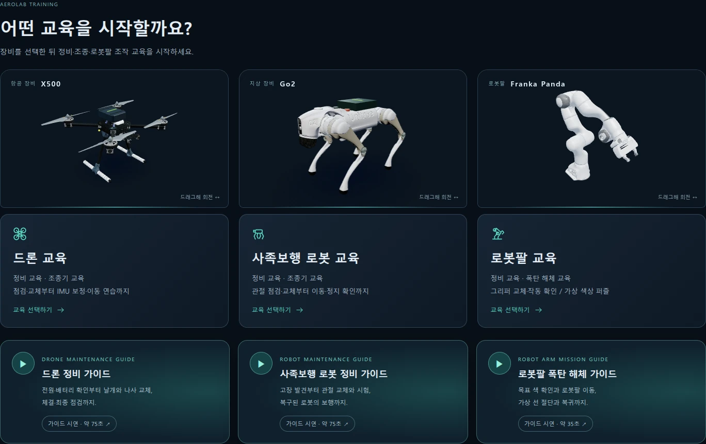](docs/screenshots/overview.webp)

| 장비 | 정비 실습 | 조종 실습 |
| --- | --- | --- |
| **PX4 X500 드론** | 배터리 점검, 손상 프로펠러 판별과 교체 | 조종기 연결, 자세 센서 보정, 전진·후진·제자리 회전 |
| **Unitree Go2 사족보행 로봇** | 네 다리 점검, 손상 관절 모듈 교체와 작동 시험 | 본체 전원 켜기, 보행·회전·비상 정지 |
| **Franka Panda 로봇팔** | 손상된 그리퍼(집게) 교체와 개폐 시험 | ‘폭탄 해체 교육’이라는 가상 색상 퍼즐에서 집게 원격 조종 |

## 빠른 시작

**Python 3.10 이상**과 **Chrome 또는 Edge**를 준비합니다. 3D 모델과 화면을 그리는 데 필요한 파일이 저장소에 들어 있어, 한 번 내려받으면 인터넷 연결 없이 실행할 수 있습니다.

**WSL · Linux · macOS** 터미널에서 실행합니다.

```bash
git clone https://github.com/sdk17586/dron_sim.git
cd dron_sim
./start.sh
```

**Windows**에서는 저장소를 내려받아 압축을 풀고 폴더 안의 `start-windows.bat`을 더블 클릭합니다.

실행 창을 열어 둔 채 같은 PC의 브라우저에서 [AEROLAB 열기 · 127.0.0.1:8000](http://127.0.0.1:8000/)를 선택합니다. WSL로 실행한 경우에도 Windows 브라우저에서 이 주소를 엽니다. 종료하려면 서버를 실행한 창에서 `Ctrl+C`를 누릅니다.

<details>
<summary>8000번 포트를 이미 사용 중이라면</summary>

기존 AEROLAB이 실행 중이면 위 주소로 바로 접속합니다. 다른 프로그램이 8000번을 사용한다면 프로젝트 폴더에서 다음처럼 포트를 지정하고, 브라우저에서도 같은 포트를 엽니다.

```bash
python3 tools/serve.py --port 8001
```

[8001번 포트로 열기](http://127.0.0.1:8001/)

</details>

## 처음 체험하는 분께

첫 화면에서 **사족보행 로봇 정비 가이드**를 누르면 약 75초 동안 관절을 교체하고 로봇이 다시 걷는 과정을 볼 수 있습니다. 드론 정비 가이드는 약 75초, 로봇팔 조종 가이드는 약 35초입니다.

[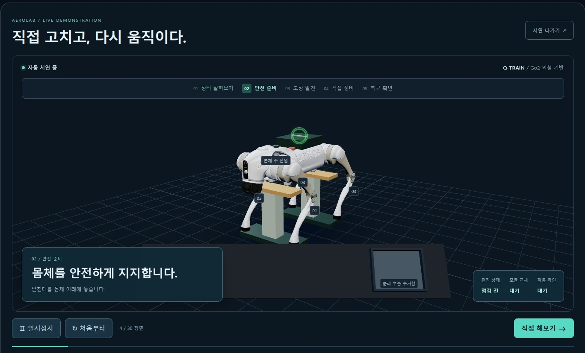](docs/screenshots/go2-guide.webp)

직접 해보려면 첫 화면의 **드론 교육 → 정비 교육**을 선택합니다. **지금 할 일**에 첫 작업이 나오고, 3D 드론 위에서 눌러야 할 전원 버튼이 초록색으로 빛납니다. 부품을 찾기 어려울 때는 **위치 보기**로 가까이 살펴볼 수 있습니다. 아래 실습 사진을 클릭하면 큰 화면으로 볼 수 있습니다.

## 드론 · 프로펠러 점검에서 첫 기체 이동까지

**정비 교육**에서는 전원과 배터리를 확인한 뒤 네 모터의 날개를 하나씩 살펴봅니다. 손상된 날개를 찾으면 작업대의 드라이버로 나사를 풀고, 교체용 날개를 장착한 뒤 체결 상태를 확인합니다.

| 처음 만나는 정비 작업대 | 프로펠러 손상 판별 |
| --- | --- |
| [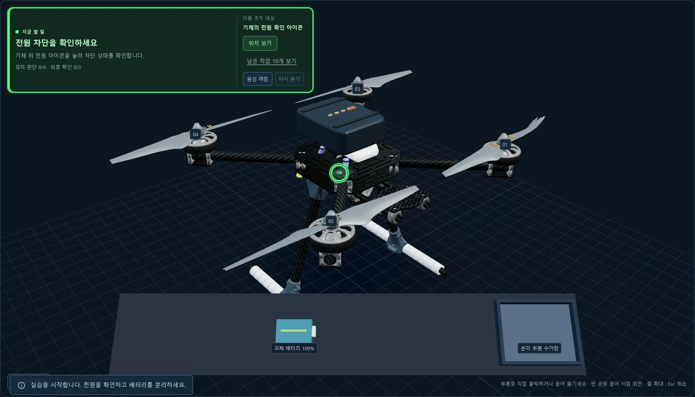](docs/screenshots/x500-workshop.webp) | [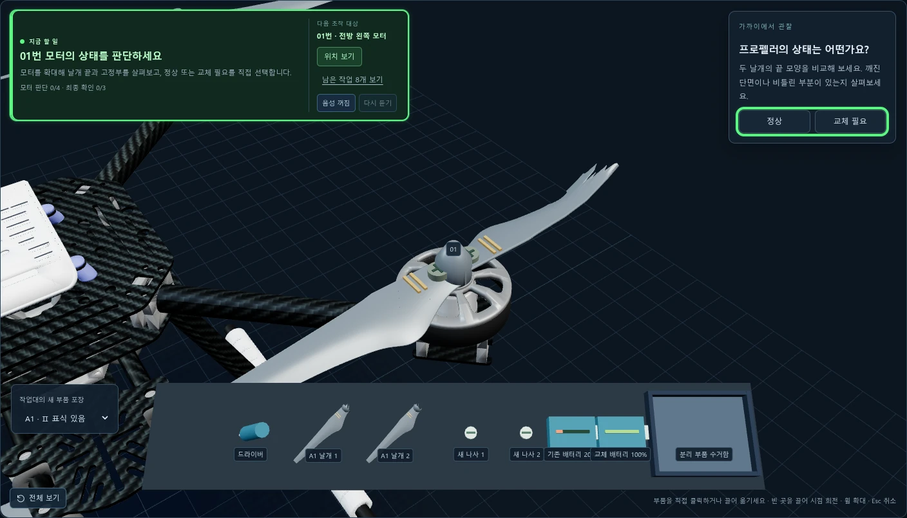](docs/screenshots/x500-damage.webp) |

**조종기 교육**에서는 기체와 조종기의 전원을 켜고 연결한 뒤 스틱 입력을 확인합니다. 이어서 기체를 여섯 자세로 돌려 자세 센서(IMU)를 보정합니다. 양옆은 편한 쪽부터 한 번씩 측정하면 됩니다. 보정을 마치면 왼쪽 스틱으로 전진·후진하고 오른쪽 스틱으로 제자리에서 회전합니다.

| 옆면으로 돌려 자세 측정 | 보정 후 스틱으로 전진 |
| --- | --- |
| [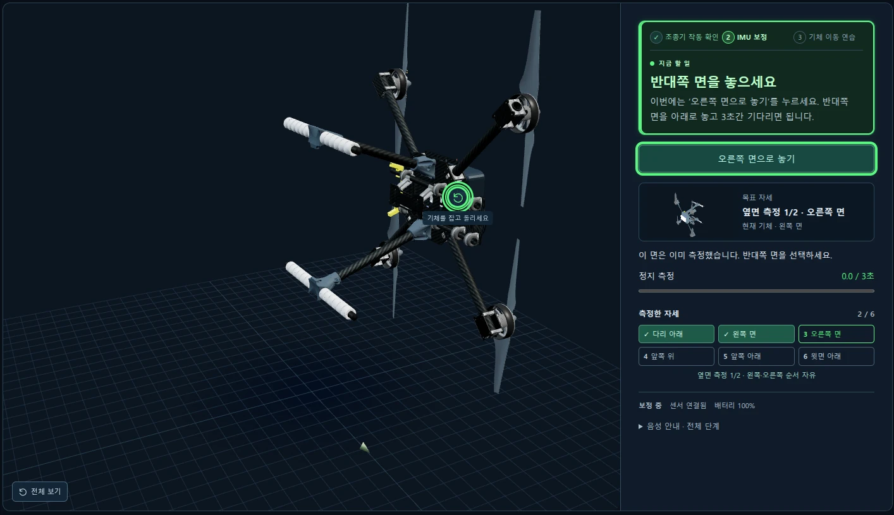](docs/screenshots/x500-imu.webp) | [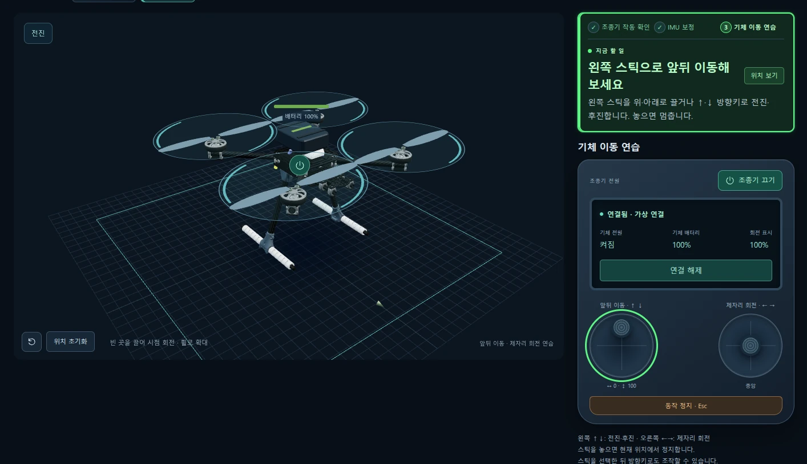](docs/screenshots/x500-flight.webp) |

## 사족보행 로봇 · 관절 교체와 보행 시험

**정비 교육**에서는 비상 정지와 전원 차단 후 받침대로 몸체를 지지합니다. 네 다리를 점검해 교체가 필요한 관절을 고르고, 커넥터와 볼트를 분리해 새 모듈을 장착합니다. **조종기 교육**에서는 3D 로봇 본체의 전원 버튼을 직접 누릅니다. 조종기를 연결하면 스틱으로 로봇을 걷게 하거나 방향을 바꾸고 비상 정지를 시험할 수 있습니다.

| 무릎 관절의 손상 확인 | 가상 조종기로 보행과 회전 연습 |
| --- | --- |
| [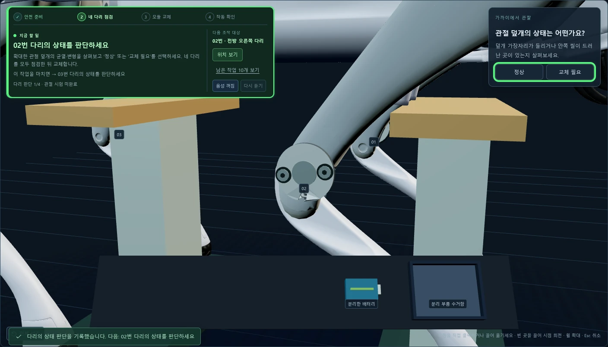](docs/screenshots/go2-joint.webp) | [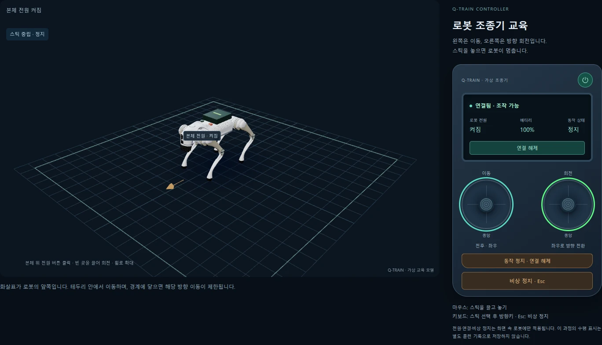](docs/screenshots/go2-controller.webp) |

## 로봇팔 · 그리퍼 교체와 원격 조작

**정비 교육**에서는 물체를 잡는 그리퍼의 손상을 관찰합니다. 커넥터와 고정 볼트를 분리해 새 그리퍼로 교체하고, 집게가 열리고 닫히는지 시험합니다. **폭탄 해체 교육**은 화면에 제시된 목표 색을 맞추는 가상 퍼즐입니다. 스틱이나 방향키로 집게를 좌우·위아래로 움직여 목표에 맞춥니다. 시간 제한이 없는 연습 모드와 90초 도전 모드 중에서 고를 수 있습니다.

| 손상된 그리퍼 점검 | 스틱으로 집게를 목표에 정렬 |
| --- | --- |
| [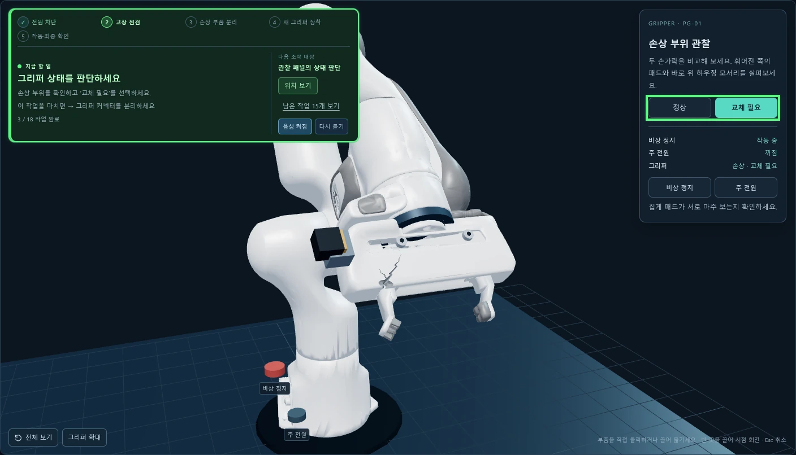](docs/screenshots/panda-gripper.webp) | [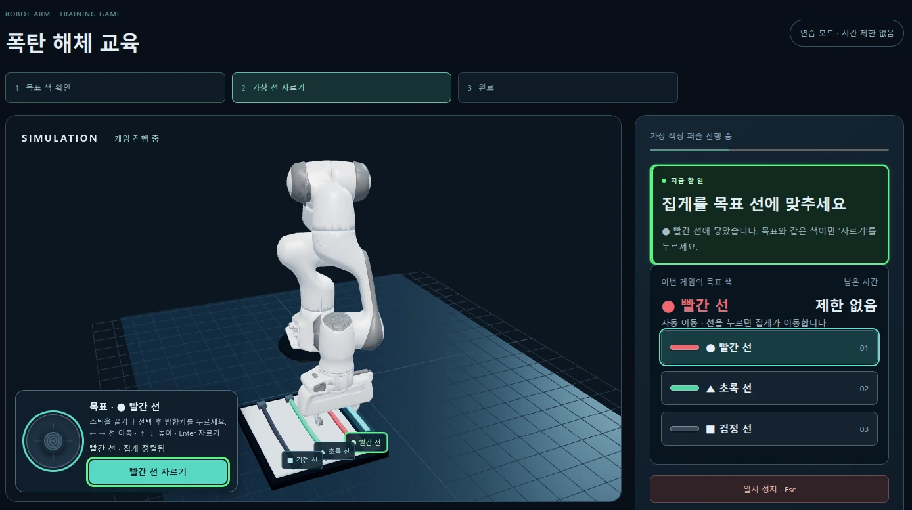](docs/screenshots/panda-controller.webp) |

## 훈련 기록과 CSV

상단의 **훈련 기록**을 열면 교육생과 회차별 수행 결과를 확인할 수 있습니다. **회차 결과 내보내기**로 CSV를 보관하고, 여러 노트북에서 실습했다면 한 노트북에서 **CSV 가져오기**로 결과를 취합합니다. 기록은 현재 브라우저에 저장되므로 다음에 다시 볼 때는 같은 브라우저 프로필과 주소·포트를 사용합니다.

[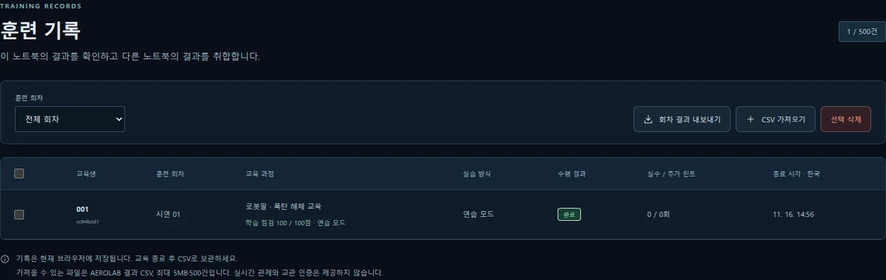](docs/screenshots/training-records.webp)

## 구현과 자료

교육 화면은 JavaScript와 Three.js로 구성했고 Python 표준 라이브러리로 로컬 서버를 실행합니다. 장비 외형에는 PX4 X500, Unitree Go2, Franka Panda의 공개 모델을 사용했습니다. 실습 절차와 부품은 장비를 처음 접하는 사람이 조작 순서를 익힐 수 있도록 단순화했습니다.

- [3D 모델과 라이브러리의 출처·사용 조건](THIRD_PARTY_NOTICES.md)
- [교육 콘텐츠의 근거와 범위](content-review.md)
- [기능별 검증 기록](validation.md)
